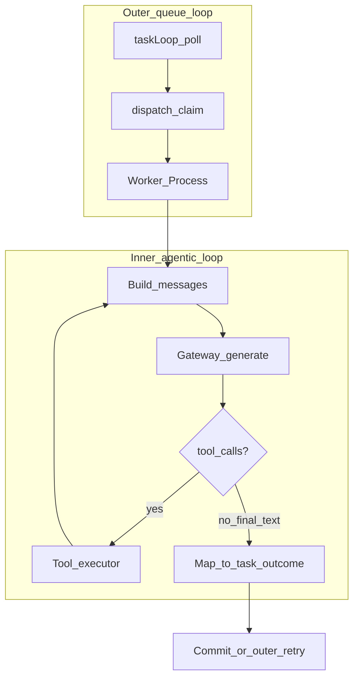

# Agentic harness architecture (agentd)

This document describes the **inner agentic loop**, the only worker path agentd runs today, and how it maps onto the codebase. The single-call contract it replaced (one LLM call, structured JSON, then sandbox) was removed in T-055b.

## Inner agentic loop

An inner agentic loop is a **per-task** cycle that:

1. Calls the LLM with a message list and tool definitions (`tools` in the chat-completions sense).
2. If the assistant message includes `tool_calls`, executes those tools and appends `role: tool` messages (with `tool_call_id`) to the history.
3. Calls the LLM again with the updated history.
4. Stops when the assistant returns **final text** without further tool calls (or when safety limits fire).

A minimal tool surface for coding agents is often three tools: `bash`, `read`, and `write`, plus a message array and a bounded loop around the gateway call.

```text
[system, user, …] → LLM → tool_calls? → execute → [tool messages] → LLM → … → final text
```



## Outer loop vs inner loop

| Layer | Responsibility | Where it lives |
| --- | --- | --- |
| **Outer loop** | Poll the store, claim ready work, run one worker invocation per claimed task, then commit, retry, heal, or hand off. | [`internal/queue/daemon.go`](../internal/queue/daemon.go) starts `taskLoop`; [`internal/queue/loop.go`](../internal/queue/loop.go) implements `taskLoop`, `dispatch`, and related intake behavior. |
| **Inner loop** | Multiple gateway round-trips **inside** a single task, accumulating assistant and tool messages until a final text response. | Implemented via `processAgentic` in [`Worker.Process`](../internal/queue/worker/worker.go); every task runs it. |

Outer retry/healing/handoff must continue to wrap the **whole** inner loop as one logical attempt (or one explicitly designed unit of work), not each tool invocation. A tool error should be returned to the model as tool output unless policy says otherwise; it should not automatically trigger the same outer path as a sandbox failure.

## Two LLM contracts

### Current (every worker task): agentic tool-calling

- Messages are built via `AssembleAgenticSystemPrompt` from `AgentProfile` and the task; the worker enters `processAgentic` and drives the agentic tool-calling loop.
- There is no single-shot JSON `command` path any more. The legacy engine that decoded a `workerResponse` was removed in T-055b, so every task takes this loop.

### Native tool calling

- Requests include **`tools`** (JSON schemas). Responses can include **`tool_calls`** on the assistant message.
- The worker appends assistant messages (including `tool_calls`) and tool result messages, then calls the gateway again until there are no more tool calls.
- **Task completion:** non-empty final assistant text without `tool_calls` ends the loop and is stored as the task result. The task is COMPLETED only when the completion checks in rule 5 below pass.

## Agentic mode flag

The **`AgenticMode`** boolean field on the `AgentProfile` entity is checked against the provider. The API accepts only `true`, and it no longer picks a worker path:

```go
type AgentProfile struct {
    // ...
    // The API accepts only true. A provider without tool calling is refused.
    // Every task runs the inner loop via processAgentic.
    AgenticMode bool
}
```

### Behavior

| `AgenticMode` | Provider | Behavior |
| --------------- | ---------- | ---------- |
| `false` | any | Refused by the API with HTTP 400. Rows stored with `false` before this change are upgraded to `true` at startup (see [init-startup.md](init-startup.md)) |
| `true` | `openai` (incl. openai-compatible e.g. LiteLLM/Portkey/OpenRouter) | Agentic mode: inner loop with tool calling; shell via `bash` tool only |
| `true` | `anthropic` (native) | **Single one tool turn only.** Multi-turn tool round-trip is broken (see [provider-tool-calling.md](provider-tool-calling.md)). For a working agentic loop on Anthropic-family models, use the managed proxy path (`adapter: openai`) instead. |
| `true` | other (native, `SupportsChatTools: false`) | Rejected: the profile cannot be created or patched with it, and a task on it fails |

### Choosing a provider

Use a provider with reliable multi-turn tool round-tripping — `openai` and any
openai-compatible endpoint (including the LiteLLM/Portkey/OpenRouter managed
proxy, via `adapter: openai`). Native `anthropic` is single-turn only (see
[provider-tool-calling.md](provider-tool-calling.md)); for Anthropic-family
models, route through the managed proxy path with `adapter: openai` instead.

Every task goes through `processAgentic()`, the inner loop with tool calling. There is no second path.

## Sandbox model in agentic mode

The inner loop runs shell commands through the same hardened [`BashExecutor`](../internal/sandbox/executor.go):

| Step | How it works |
| --- | --- |
| LLM contract | Repeated `Generate` with `tools` until no `tool_calls` |
| Shell execution | Only via the **`bash` tool** (and `read` / `write` for files) inside the inner loop |
| Task completion | Final assistant **text** → `commitTextWithProfile` (no extra sandbox run for that text) |

**Rules:**

1. The inner tool loop is the only execution path. If the resolved provider cannot round-trip tool calls, the task fails with `agentic profile's provider cannot call tools`; there is no fallback to a single-shot command (see [provider-tool-calling.md](provider-tool-calling.md)).
2. The per-task tool manifest is applied by [`FilterAgenticTools`](../internal/queue/worker/worker_tools.go). It limits the tools sent in turn-loop gateway requests and decides whether a task can join a batch. Routing does not depend on it: the agent is picked by purpose (see [config-reference.md](config-reference.md#routing-agents-and-stages)).
3. Each `bash` tool invocation is a separate sandbox execution (subject to hooks, timeouts, and scrubbing).
4. Non-empty final assistant text without further `tool_calls` ends the loop; it is stored as the task result payload, not executed as a shell command.
5. A finish is not COMPLETED when a text-only finish follows a failed shell command, when a success-criteria file it names is missing, empty or does not parse, or when breakdown subtasks are still open. Those finishes are stopped instead (see [`verify.go`](../internal/queue/worker/agentic/verify.go)).

## Conversation persistence across BLOCKED → READY

The inner loop accumulates `PromptMessage` history **in memory** for one `Worker.Process` call. If a gated tool suspends the loop (approval gate → task `BLOCKED`), a later `Process` after the human unblocks the parent **rebuilds** messages from [`assembleAgenticSystemPrompt`](../internal/queue/worker/worker_messages.go). Prior assistant/tool turns from the suspended attempt are **not** restored automatically; the model must re-issue tool calls or continue from the fresh system + user seed. Persisting partial
transcripts is planned follow-up work (see the forward milestones in the
[roadmap](agentic-harness-roadmap.md)).

## How concepts map in agentd today

### Tools

| Concept | agentd today |
| --- | --- |
| Shell execution | [`internal/sandbox/executor.go`](../internal/sandbox/executor.go) — `BashExecutor.Execute()` with sudo blocking, path jailing, ulimits, scrubbing, inactivity timeout. |
| Read/write as **LLM-invokable** tools | Exposed as `bash`, `read`, and `write` tool definitions via `ToolExecutor` in [`tool_executor.go`](../internal/agent/tools/tool_executor.go). They are advertised to the LLM and executed through the inner loop. |

### Tool definitions and parsing

| Concept | agentd today |
| --- | --- |
| `tools` on API requests | Wired via `AIRequest.Tools` field in [`internal/gateway/spec/spec.go`](../internal/gateway/spec/spec.go). The inner loop populates `Tools` with executor and capability definitions. |
| `tool_calls` on responses | Parsed via `AIResponse.ToolCalls` and `PromptMessage.ToolCalls`/`ToolCallID` in [`internal/gateway/spec/spec.go`](../internal/gateway/spec/spec.go). OpenAI provider maps response tool calls in [`internal/gateway/providers/openai.go`](../internal/gateway/providers/openai.go). |

### Messages and history

| Concept | agentd today |
| --- | --- |
| Per-task messages | Built per invocation; [`PromptMessage`](../internal/gateway/spec/spec.go) includes `role`, `content`, `tool_calls`, and `tool_call_id`. In agentic mode, assistant messages carry `tool_calls` and tool result messages carry `tool_call_id`. |
| Tool results in the model context | Tool results are appended as `role: tool` messages with `tool_call_id` for the next gateway call. A retry or a recovered re-run builds a fresh prompt from the task, profile and recalled memory; no output from the earlier attempt is carried in. Retries reuse the workspace files as they stand; recovered re-runs do too, unless boot recovery empties an eligible project first via `recovery.clean_workspace_on_recover` (see [recovery-rerun.md](architecture/recovery-rerun.md)). |
| Event stream | First-class tool events exist: `TOOL_CALL` and `TOOL_RESULT` are persisted event types carrying scrubbed/truncated payloads, emitted by worker + audit hooks and mapped to SSE `tool_called` / `tool_result` — see [`internal/models/enums.go`](../internal/models/enums.go), [`worker_events.go`](../internal/queue/worker/worker_events.go), and [`internal/api/sse/stream.go`](../internal/api/sse/stream.go). Cockpit rendering is complete — see the [tool-event payload contract](sse-events.md#tool-event-payload-contract) and `web/`. |

### Client / input surface

| Concept | agentd today |
| --- | --- |
| Chat HTTP API | OpenAI-compatible handlers under [`internal/api/controllers/`](../internal/api/controllers/) (e.g. chat completions). |

## Production capabilities that already exist

These support the outer system and **wrap** the inner agentic loop:

- Multi-provider routing with fallback and circuit breaking.
- Task breakdown, parameter tuning on retry, human handoffs.
- Hardened sandbox, concurrent workers, persistent kanban state, memory subsystem, intent classification, token budgets, truncation strategies, and scheduled daemon loops.

## Related files

| Path | Role |
| --- | --- |
| [`internal/gateway/spec/spec.go`](../internal/gateway/spec/spec.go) | `AIRequest`, `AIResponse`, `PromptMessage`, truncation and budget interfaces. |
| [`internal/gateway/providers/openai.go`](../internal/gateway/providers/openai.go) | OpenAI HTTP request/response shapes. |
| [`internal/queue/worker/worker.go`](../internal/queue/worker/worker.go) | `Process`, gateway calls, sandbox orchestration. |
| [`internal/queue/worker/worker_support.go`](../internal/queue/worker/worker_support.go) | Sandbox env, heartbeat, and tool result parsing. |
| [`internal/queue/worker/worker_addons.go`](../internal/queue/worker/worker_addons.go) | Result/failure/prompt payload formatting. |
| [`internal/queue/worker/worker_events.go`](../internal/queue/worker/worker_events.go) | Structured tool-call and tool-result event payloads. |
| [`internal/queue/worker/worker_retry.go`](../internal/queue/worker/worker_retry.go) | Retry and healing. |
| [`internal/queue/worker/worker_handoffs.go`](../internal/queue/worker/worker_handoffs.go) | Handoff creation. |
| [`internal/queue/daemon.go`](../internal/queue/daemon.go) | Daemon lifecycle; starts outer loops. |
| [`internal/queue/loop.go`](../internal/queue/loop.go) | `taskLoop`, `dispatch`. |
| [`internal/sandbox/`](../internal/sandbox/) | Execution, adapters, safety limits. |

## See also

- [docs/agentic-harness-roadmap.md](agentic-harness-roadmap.md) — Phased implementation roadmap.
- [docs/provider-tool-calling.md](provider-tool-calling.md) — Provider tool-call capability matrix and wire-format deltas.
- Long-term connector design lives in [docs/llm-connector-strategy.md](llm-connector-strategy.md).
